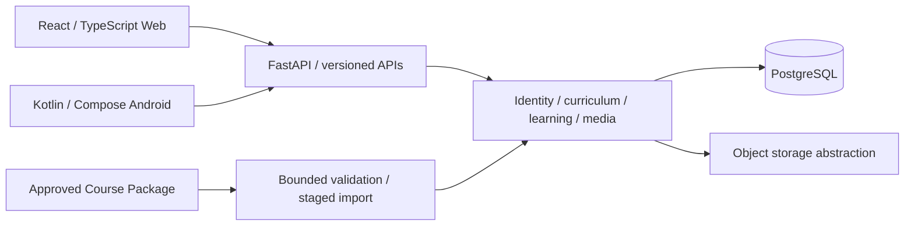

# NorskAllstars

**Learn the language. Follow the road. Enter the North.**

NorskAllstars is a Norwegian Bokmål learning platform with a responsive Web
application and a native Android app. It combines comprehensible input and the
Natural Method with a shared backend for accounts, course releases and private
learner progress.

## Platform capabilities

- **Web and native Android:** account journeys, course navigation, illustrated
  text, audio playback, explicit available translations and interactive activities.
- **Learning Core:** server-evaluated activities, linear mastery gates, optional
  advisory placement, completion, replay, review and private attempt history.
  Completed lessons remain replayable without erasing canonical completion.
- **Shared identity:** email/password registration, verification/recovery,
  Google sign-in integration, revocable sessions/devices, preferences, sensitive
  changes with fresh proof, and account deletion.
- **Course continuity:** immutable versioned releases and release-pinned learner
  enrollments. Publishing new content does not silently reinterpret prior progress.
- **Media infrastructure:** authenticated image/audio delivery, object-storage
  adapters, retention/reconciliation and consent-based selective recording uploads.

These capabilities are implemented and tested. This repository does not claim a
production deployment, production users or production-scale validation. Live
external-provider integrations are environment-specific and are not exercised
against production services in CI.

## Learning and experience

Norwegian content remains the learning focus; translations are explicit rather
than automatic. Progress and mastery come from persisted evidence and versioned
policies, with no invented default pedagogical threshold. Placement recommends a
starting point without fabricating completion.

The [World & Experience Bible](docs/product-world/README.md) defines the product's
long-term world and visual direction: contemporary Norway, human continuity,
North outside / warmth inside, and pedagogy before spectacle. Existing client
visuals are not the normative design reference. [Experience Contract v1](docs/product-world/experience-contract-v1.md)
is the public semantic boundary between authored experience and platform
presentation, distinct from Course Package ingestion and canonical learner progression.

## Architecture

A public monorepo contains a modular backend and two API clients. The backend owns
identity, authorization, course releases, evaluation and progress. Clients own
presentation and platform interaction; they do not parse Course Packages or
independently grant learning credit.



The backend uses Python, FastAPI, Pydantic, SQLAlchemy and Alembic. Persistence is
PostgreSQL; storage supports local development and an S3-compatible adapter.
Web uses React/TypeScript and Vite. Android uses Kotlin/Jetpack Compose, Android
Keystore-protected sessions and lifecycle-aware media handling. Docker/Compose
provides the local backend/database runtime.

See [architecture](docs/architecture/README.md),
[API contracts](docs/api/README.md) and [architecture decisions](docs/adr/README.md).

## Content boundary

Authored teaching materials belong to a separate private Corpus. This platform
has no direct dependency on its repository or internal structure. Integration
uses **Course Package Contract v1**, with bounded archive/schema/checksum checks,
immutable staged releases and an explicit audited publication boundary.

Public automated tests and development use approved synthetic fixtures, which
remain release-ineligible. Real lessons, private packages, prompts and production
media are excluded from this repository. **No private package is required or accepted.**
See [Course Package integration](docs/corpus-integration/README.md).

## Security and privacy engineering

Authorization and account ownership are enforced server-side. Learner responses
and progress are private; clients do not authorize access using supplied user IDs.
Browser sessions remain in memory; Android credentials use device-bound encrypted
storage. Recording submission requires separate consent and server selection.

CI checks include PostgreSQL/migration regressions, generated API drift, browser
E2E/accessibility, native device tests, dependency audits, CodeQL for Python,
Web and Android, and index/history confidentiality and secret checks. These
controls complement review; they do not establish production readiness.
[Security policy](SECURITY.md) · [Security engineering](docs/security/README.md)

## Repository map

| Path | Purpose |
| --- | --- |
| `apps/backend/` | FastAPI runtime, domain modules, migrations and tests |
| `apps/web/` | React client and browser/component tests |
| `apps/android/` | Native Compose app, locked toolchain and device tests |
| `contracts/` | Versioned public APIs, learning policy and Course Package artifacts |
| `infra/` | Local Docker runtime and infrastructure boundaries |
| `scripts/` | Development, validation, receiving and security tooling |
| `docs/` | Architecture, product authority, developer guides and review evidence |

## Run locally

For authorized development under [LICENSE](LICENSE), install Git, repository
Python **3.14.2**, backend Python **3.13.16**, uv **0.12.23**, Node **24.21.0**
and Docker/Compose. Backend dependencies use `uv.lock`; Web uses
`package-lock.json` and `npm ci`.

From the repository root:

```sh
make bootstrap
make hooks
python3 scripts/phase1.py init
python3 scripts/phase1.py up
python3 scripts/phase1.py smoke
```

The commands start PostgreSQL, apply migrations and serve the backend and built
Web client using local development configuration. Open **http://127.0.0.1:8000/**.
No production credentials or external providers are required.

The [development guide](docs/development.md) covers hot reload, local accounts,
synthetic data, validation commands, shutdown and platform-specific setup.
The [native guide](apps/android/README.md) covers Android's pinned JDK/Gradle/SDK,
installation and emulator/device networking.

## Explore further

[Documentation index](docs/README.md) · [Production roadmap](ROADMAP.md) ·
[Current engineering state](PROJECT_STATE.md) · [Actionable tasks](TASKS.md) ·
[Contributor/agent instructions](AGENTS.md) · [Changelog](CHANGELOG.md)

## License

**Proprietary — Copyright (c) 2026 Oleg Marikov. All Rights Reserved.**
Source is visible for review; reuse requires prior explicit written permission,
with attribution when authorized. Third-party components retain their own licenses.
See [LICENSE](LICENSE) for the full notice and applicable-law/platform-terms qualifications.
