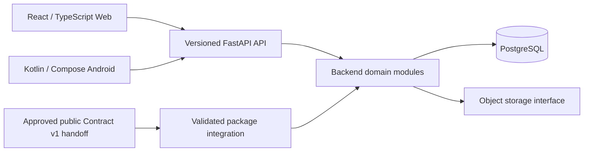

# Architecture

[Product-world authority](../product-world/README.md) owns normative experience
direction. [Experience Contract v1](../product-world/experience-contract-v1.md) is approved
and normative; implementation and the approved first slice have NOT started;
Course Package Contract v1 and its current data boundary remain unchanged.

The platform is a monorepo with one modular backend and two online clients.
Python/FastAPI, PostgreSQL/SQLAlchemy/Alembic, React/TypeScript and native Kotlin/
Compose are implemented. [Identity](identity.md), [Learning Core](learning-core.md)
and [Web/media](../web/README.md) share versioned backend contracts with
[native Android](../android/README.md). Production deployment and later roadmap
capabilities remain separate work. Client visuals are not normative design precedent.

The handoff is an artifact boundary, never a private-repository dependency.
Production corpus/media stay outside source control and public CI.

| Boundary | Ownership |
| --- | --- |
| Backend | Canonical learning rules, authorization, progress and entitlements |
| Web / Android | Presentation, accessibility, local interaction and platform capabilities |
| Android persistence | Later offline operations and version-aware synchronization |
| Public API contracts | Client compatibility and reviewed interface evolution |
| Course Package Contract | Upstream-defined data interchange; imported unchanged after approval |
| Infrastructure | Environment definitions; secrets injected externally |

Use domain modules rather than services by default. Implemented domains include identity, curriculum/release management, learning/
evaluation, progress/review and media. Gamification, access/billing and administration
remain roadmap work. Runtime layout is described in [backend runtime](backend-runtime.md).
Each module owns its persistence and public interfaces. Avoid cross-module ORM
writes and shared mutable domain logic. Public DTOs do not expose storage models.
The backend is authoritative; clients do not independently decide access rights,
canonical mastery, purchases, or reconciliation outcomes.

[ADRs](../adr/README.md) capture accepted engineering decisions.
[Product direction](product-direction.md) preserves the public release baseline.
